# LearnWithMe — 3D AI Dyslexia Learning Companion

**A voice-enabled, dyslexia-aware learning website with animated 3D tutors, structured phonics lessons, independent practice, beginner reading and playful literacy games.**

**Live Website:** https://learnwithme-eta.vercel.app/  
**Backend Health:** https://learnwithme-api.onrender.com/health


## Project Summary

LearnWithMe is a web-based literacy learning companion designed to make early reading practice calm, visual and interactive. It combines two animated 3D characters with guided word lessons, browser microphone input, optional spoken prompts, short reading activities, and phonics mini-games. The app encourages small steps and retrying answers without time pressure.

The system splits responsibilities deliberately: **Wendy** guides teaching; **Bob** helps learners practise and reinforce skills. Core lesson correctness is determined by a predictable backend lesson engine rather than allowing a language model to decide right and wrong answers. Open-ended companion conversations can use a remote free-model provider, while selected educational intents are handled through local rules.

**Project highlights:** React/Vite user interface, Three.js 3D characters, FastAPI Python backend, signed-cookie parent accounts, Neon PostgreSQL, and a public Vercel/Render deployment.

## Meet Our 3D Learning Companions

<table>
<tr>
<td align="center" width="50%">

### Wendy — Teaching Buddy


**Learn with Wendy**

Wendy is a patient teaching companion who helps children
learn letters, phonics, blending, word recognition, and reading
through small, manageable steps.

</td>
<td align="center" width="50%">

### Bob — Practice Buddy

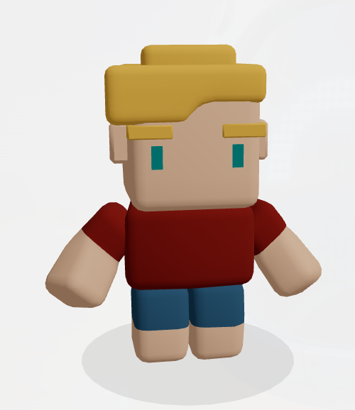

**Practice with Bob**

Bob helps learners build confidence with speaking,
spelling, word challenges, and encouraging feedback
at their own pace.

</td>
</tr>
</table>


## Visual Experience

| Page / experience | What the learner sees |
| --- | --- |
| Welcome / landing | Introductory hero and parent login |
| Dashboard | Quick access to all learning modules |
| Wendy lessons | 3D tutor, word, step-based explanation, typed or spoken answers |
| Wendy companion stage | Large 3D character, chat input, speech button and optional response audio |
| Bob practice | 3D practice buddy, confidence-building challenges, stars |
| Phonics games | Four self-paced interactive literacy exercises |
| Reading | Simple text passages with audio option |
| Accessibility settings | Larger text and reduced motion options |

The full gallery of **13 original LearnWithMe screenshots** is included at the **end of this README** under [Screenshots](#-screenshots).

## Contents

- [About the project](#-about-the-project)
- [Features at a glance](#-features-at-a-glance)
- [How learning works](#-how-learning-works)
- [System architecture](#-system-architecture)
- [Technology stack](#-technology-stack)
- [Project structure](#-project-structure)
- [Getting started locally](#-getting-started-locally)
- [Environment configuration](#-environment-configuration)
- [API overview](#-api-overview)
- [Deployment](#-deployment)
- [Accessibility, privacy and safety](#-accessibility-privacy-and-safety)
- [Testing and known limitations](#-testing-and-known-limitations)
- [Roadmap](#-roadmap)
- [Screenshots](#-screenshots)

---

## 💡 About the project

Learning to read can be challenging when an interface moves too quickly, emphasizes failure, or demands long blocks of text. **LearnWithMe** explores an alternative: a reassuring 3D companion, small guided steps, phoneme-oriented practice, accessible controls, and opportunities to try again without penalties.

The application separates **guided instruction** from **independent practice**:

- **Wendy — Learning Buddy:** teaches letter recognition, sounds, blending, and word reading; also provides a 3D conversational learning stage with text and voice input.
- **Bob — Practice Buddy:** reinforces early literacy through first-letter, spelling, and reading challenges with encouragement and stars.
- **Phonics Games:** hands-on letter tracing, word building, memory matching, and sound/letter catching.
- **Reading:** short beginner-friendly passages with a read-aloud option.
- **Parent area:** account registration/sign-in, access to learning pages, and an interface for progress (persistent progress tracking is under improvement).

### Project principles

| Principle | Implementation approach |
| --- | --- |
| Confidence before speed | No compulsory countdowns or punishing timers in the showcased games |
| Short, manageable steps | Letter → sound → blend → read teaching sequence |
| Multiple ways to respond | Typed answers, speech recognition where supported, click/tap interactions |
| Encouragement | Hints, repeat controls, positive feedback, practice stars |
| Sensory choice | Larger-text and reduced-movement preferences; stage day/night mode |
| Human-guided learning | Deterministic lesson correctness, with optional cloud AI for open-ended questions |

## ✨ Features at a glance

| Module | Capabilities | Notes |
| --- | --- | --- |
| 🏠 Landing & dashboard | Introductory homepage, navigation, quick links | Deployed |
| 👩‍🏫 Wendy guided lessons | Beginner vocabulary, recognition, phonics, blending, read-aloud, text/voice answers, hints and restart | 22 lesson words across 3 levels; currently 4 active stages per word |
| 🗣️ Wendy 3D stage | Animated `.glb` character, typed messages, browser microphone, response panel, optional AI replies | Free hosted AI is quota-dependent; certain intents use local teaching rules |
| 👦 Bob practice | First-letter, spelling and reading challenges; stars, retry and next challenge | Browser-local stars demonstrated; database synchronization not fully validated |
| ✍️ Letter tracing | Trace over letter shapes using pointer/touch | Gentle, self-paced activity |
| 🔤 Word builder | Arrange letters to form words | Includes word audio |
| 🧠 Memory match | Match letters to their phonetic sounds | Visual flip-card interaction |
| 🎯 Letter catch | Select the letter for a target sound; keyboard 1–4 option | Includes feedback and reward indicators |
| 📚 Reading | Short sentences and reading audio | Starter reading material |
| ♿ Preferences | Larger text, reduced motion, stage day/night appearance | Coverage and persistence should be tested across routes/devices |
| 🔐 Parent accounts | Register, sign in, sign out, session validation | FastAPI signed session cookies and PostgreSQL users |
| 📊 Progress | Progress-related UI and backend endpoints | End-to-end student progress remains incomplete |

## 🎓 How learning works

### Wendy's structured teaching pathway

Learners select a **level**, choose a **word**, and work through small actions:

1. **Recognize** — identify an individual letter in the target word.
2. **Learn sounds** — hear and explore individual sounds or sound groups.
3. **Blend** — connect the sounds into a complete word.
4. **Read** — attempt to read the word independently.

The content library also defines **sentence-use** material for future expansion. The deployed guided progression currently uses four stages, so sentence-use is not presented here as a completed fifth active stage.

**Lesson progression:**

| Level | Focus | Examples |
| --- | --- | --- |
| 1 — First Words | Early consonant-vowel-consonant words | CAT, SUN, MAT, SAT, PIN, TIN, PAN, BAT |
| 2 — Growing Reader | Additional short-vowel word families | DOG, PIG, HEN, PEN, BED, RED, CUP, BUS |
| 3 — Sound Teams | Common digraphs | SHIP, SHOP, FISH, CHIP, CHAT, THIN |

Letter identification and answer checking are performed by the lesson engine, **not left to a generative AI model**. This helps maintain consistent exercise progression. Note that pronunciation and syllable-generation behavior still need linguistic review, particularly for unfamiliar words.

### Bob's practice pathway

```text
Choose level → See short challenge → Type / speak answer
             → Receive supportive feedback
             → Earn a star for success → Next challenge
```

### Voice interaction

- **Speech input:** browser speech-recognition support (most reliable in compatible Chromium browsers, with microphone permissions granted).
- **Speech output:** server-side Piper TTS when available, with browser speech-synthesis fallback; phoneme audio recordings for designated sounds.
- **Text alternative:** learners can type answers and use click/tap controls where supported.
- Speech support and language/voice quality depend on the browser and device; it should not be described as universally supported.

## 🏗️ System architecture

The application uses an independently hosted **React single-page frontend**, a **FastAPI REST service**, a **managed PostgreSQL database**, and an **optional hosted AI service**. The visitor's device does **not** need to connect to the developer's laptop.

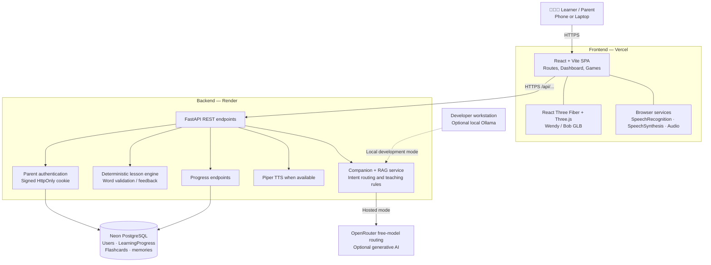

### Request flow: a typical guided answer

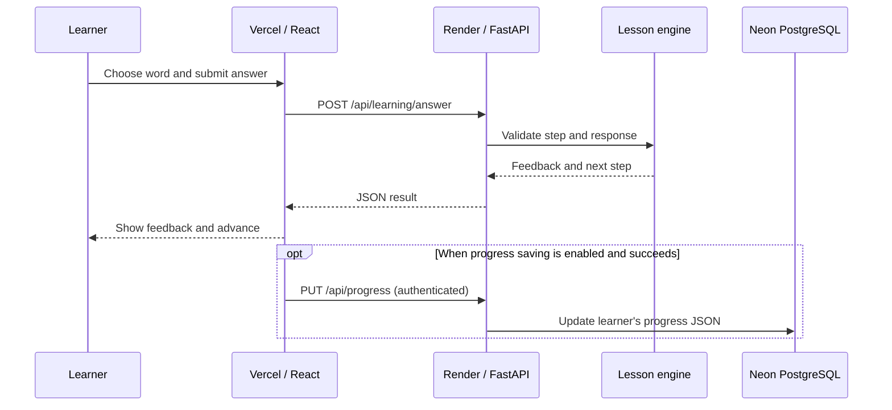

### Request flow: an open-ended companion question

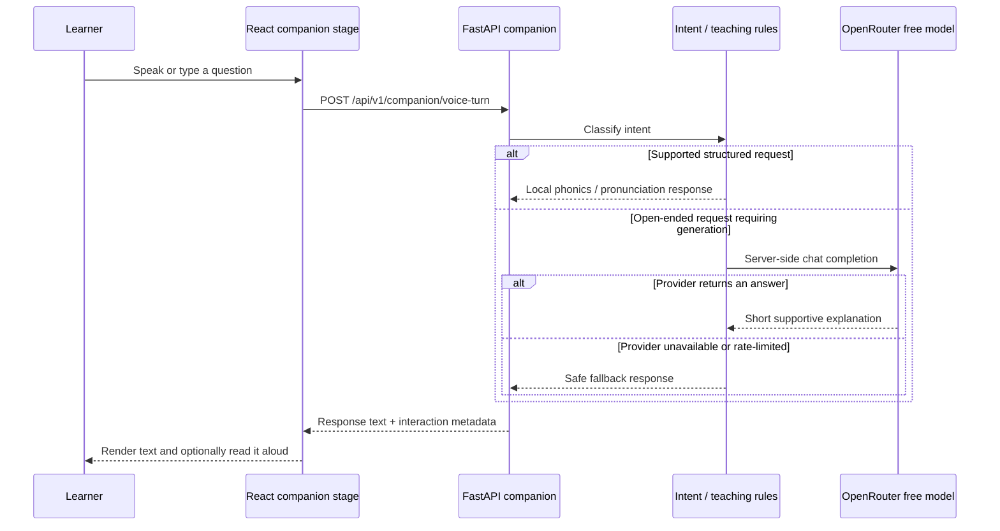

> **Important distinction:** A friendly answer in the UI does not automatically prove that the hosted model ran. The API may report `source: local-rules`, `mock-rag`, or another generation source. A cloud-backed answer must be verified using response metadata and provider availability.

## Why the learning engine is separate from AI

A generative model can help explain concepts in friendly language, but it can also make inconsistent choices. LearnWithMe therefore uses a **hybrid design**: validated word progression and exercise feedback are handled by deterministic lesson/practice logic, while optional AI chat supports open-ended questions. This keeps essential classroom-style exercises predictable even when free AI inference is unavailable.

### Data and interaction flow

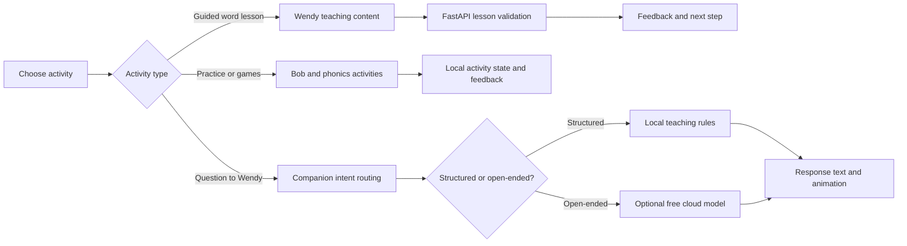

## 🧰 Technology stack

| Layer | Technology | Role |
| --- | --- | --- |
| UI | React 18, JavaScript, CSS | Interactive single-page application |
| Tooling | Vite 6, npm | Local development and production bundle |
| Routing | React Router | Home, authentication, stage, lessons, games, reading and settings |
| 3D | Three.js, React Three Fiber, Drei | Interactive GLB character models and animation |
| Browser audio | Web Speech API, Audio API | Voice input, speech fallback and phoneme playback |
| API | Python, FastAPI, Uvicorn, Pydantic | Backend endpoints, validation and service coordination |
| Storage | SQLAlchemy, PostgreSQL / SQLite | Accounts and structured persistent records |
| Security | PBKDF2-HMAC-SHA256, signed HttpOnly cookies | Password verification and sessions |
| AI | OpenRouter (free-only routing), local Ollama | Hosted/open-ended or local-development language generation |
| Retrieval | Rule-based and RAG service | Educational intent routing and optional context retrieval |
| Text to speech | Piper; browser fallback | Spoken feedback |
| Deployment | Vercel, Render, Neon | Hosted frontend, backend and managed database |

## 🗂️ Project structure

The following map focuses on the components used by the current experience. The repository may include additional legacy prototypes, docs and deployment experiments.

```text
LearnWithMe-Merged/
├── frontend/
│   ├── public/
│   │   ├── doodles/                # Wendy / Bob and related 3D GLB assets
│   │   ├── audio/                  # Phoneme recordings (if present in current checkout)
│   │   └── videos/                 # Background video assets
│   ├── src/
│   │   ├── app/App.jsx             # React application / routing
│   │   ├── auth/                   # Authentication context
│   │   ├── components/
│   │   │   ├── companion/          # 3D canvas / model renderer
│   │   │   └── practice/           # BobPractice component
│   │   ├── pages/
│   │   │   ├── HomePage.jsx
│   │   │   ├── LoginPage.jsx
│   │   │   ├── RegisterPage.jsx
│   │   │   ├── CompanionStagePage.jsx
│   │   │   └── LearningPages.jsx   # Lessons / dashboard / reading / settings
│   │   ├── data/
│   │   │   ├── teachingLessons.js
│   │   │   └── practiceWords.js
│   │   ├── games/                  # Phonics games and game logic
│   │   ├── services/               # HTTP API clients
│   │   ├── audio/                   # Speech and phoneme helpers
│   │   ├── hooks/                   # Browser speech integration
│   │   └── styles/                  # UI styling
│   ├── tests/                       # Frontend logic tests
│   ├── package.json
│   ├── package-lock.json
│   ├── vite.config.js
│   └── vercel.json
├── backend/
│   ├── app/
│   │   ├── main.py                 # FastAPI app + CORS + routers
│   │   ├── config.py               # Environment-driven settings
│   │   ├── database.py             # SQLAlchemy engine and sessions
│   │   ├── models.py               # User, LearningProgress, etc.
│   │   ├── api/
│   │   │   ├── auth.py
│   │   │   ├── learning.py
│   │   │   ├── progress.py
│   │   │   ├── dybrain.py
│   │   │   └── v1/companion.py
│   │   ├── schemas/                # Request/response models
│   │   └── services/
│   │       ├── auth_service.py
│   │       ├── lesson_service.py
│   │       ├── companion_service.py
│   │       ├── rag_service.py
│   │       ├── local_ai_service.py
│   │       └── tts_service.py
│   ├── tts/voices/                 # Piper voice models (large binary assets)
│   ├── tests/
│   ├── requirements.txt
│   └── requirements-production.txt # Production subset, if present
├── docs/
│   ├── screenshots/                # Images referenced in THIS README
│   └── ...                         # Design / architecture notes
├── .gitignore
└── README.md
```

The screenshot bundle supplied with this README creates `docs/screenshots/`. Keep that directory beside `README.md` as shown above.

## 🚀 Getting started locally

### Prerequisites

- Git
- Node.js and npm compatible with Vite 6
- Python **3.12** recommended for this project
- Chrome or another browser with compatible Web Speech API support (for microphone features)
- Optional: Ollama and its local models, for conversational AI development
- Optional: Piper executable and configured voice-model files, for server-generated speech

### 1. Clone the repository

```bash
git clone https://github.com/Payoshnee/LearnWithMe-3D-AI-Dyslexia-Learning-Companion.git
cd LearnWithMe-3D-AI-Dyslexia-Learning-Companion
```

### 2. Start the FastAPI backend

**Windows PowerShell:**

```powershell
cd backend
py -3.12 -m venv .venv
.\.venv\Scripts\Activate.ps1
python -m pip install -r requirements.txt
python -m uvicorn app.main:app --reload --port 8080
```

**macOS / Linux:**

```bash
cd backend
python3 -m venv .venv
source .venv/bin/activate
pip install -r requirements.txt
python -m uvicorn app.main:app --reload --port 8080
```

The backend defaults to **SQLite** for development when `DATABASE_URL` is unset. Open [http://localhost:8080/health](http://localhost:8080/health) to confirm the server is up, or [http://localhost:8080/docs](http://localhost:8080/docs) for FastAPI's interactive API documentation.

> Keep the terminal working directory set to `backend/` when running `uvicorn app.main:app`. Running it from the repository root without configuring Python's module path can result in `ModuleNotFoundError: No module named 'app'`.

### 3. Start the React frontend

In a **second** terminal:

```bash
cd frontend
npm install
npm run dev
```

Create `frontend/.env.local` (next to `package.json`, not inside `src/`):

```dotenv
VITE_API_BASE_URL=http://localhost:8080
```

Open **http://localhost:5173** (or the local URL Vite prints).

> For Vercel builds, use **npm**, with `package-lock.json`. An out-of-date `pnpm-lock.yaml` previously caused Vercel's dependency installation to fail; do not mix lockfiles without intentionally regenerating them.

### 4. Optional local AI via Ollama

If you want conversational AI when developing locally, start Ollama and pull the models configured for your environment:

```bash
ollama pull llama3.2:1b
ollama pull nomic-embed-text:latest
```

Backend `.env` example:

```dotenv
AI_PROVIDER=ollama
OLLAMA_BASE_URL=http://localhost:11434
OLLAMA_CHAT_MODEL=llama3.2:1b
OLLAMA_EMBEDDING_MODEL=nomic-embed-text:latest
```

Basic lessons, games and typed practice are designed to function without a local language model. AI conversations and server-generated audio depend on their respective service configurations.

## ⚙️ Environment configuration

### Frontend (`frontend/.env.local` or Vercel environment variables)

| Variable | Example | Purpose |
| --- | --- | --- |
| `VITE_API_BASE_URL` | `http://localhost:8080` | Base URL of FastAPI; set at **build time** for Vite |

For the public deployment, the frontend uses:

```dotenv
VITE_API_BASE_URL=https://learnwithme-api.onrender.com
```

**Only put public configuration in `VITE_*` variables. Never place API keys, session secrets, or database passwords there.**

### Backend (`backend/.env` locally; private Render environment in production)

| Variable | Example / expectation | Purpose |
| --- | --- | --- |
| `DATABASE_URL` | `sqlite:///./learnwithme.db` (local) or private Neon PostgreSQL URI | Persistent records |
| `SESSION_SECRET` | Strong random secret (private) | Signs parent session tokens |
| `SESSION_HOURS` | `168` | Session expiry in hours |
| `COOKIE_SECURE` | `false` (HTTP development), `true` (HTTPS production) | HTTPS-only session cookie |
| `FRONTEND_ALLOWED_ORIGINS` | `https://learnwithme-eta.vercel.app` | Exact comma-separated allowed browser origins, **no trailing slash** |
| `COMPANION_ENABLED` | `true` | Enable companion routes |
| `AI_PROVIDER` | `ollama` or `openrouter` | Select development or hosted AI provider |
| `OLLAMA_BASE_URL` | `http://localhost:11434` | Local Ollama endpoint |
| `OLLAMA_CHAT_MODEL` | `llama3.2:1b` | Local chat model |
| `OPENROUTER_API_KEY` | **Private key; never commit** | Hosted inference authorization |
| `OPENROUTER_MODEL` | `openrouter/free` | Free model router setting (actual hosted implementation enforces free-only routing) |
| `TTS_ENGINE` | `piper` | Server-side text-to-speech mode |
| `PIPER_BINARY_PATH` | `piper` | Piper executable location |
| `PIPER_VOICE_DIR` | `tts/voices` | Directory containing voice models |

Production sample **without secrets**:

```dotenv
COOKIE_SECURE=true
FRONTEND_ALLOWED_ORIGINS=https://learnwithme-eta.vercel.app
AI_PROVIDER=openrouter
OPENROUTER_MODEL=openrouter/free
COMPANION_ENABLED=true
# Set DATABASE_URL, SESSION_SECRET and OPENROUTER_API_KEY
# privately through Render's Environment settings.
```

**Cookie compatibility:** The public frontend (`vercel.app`) and backend (`onrender.com`) are on different sites. Session behavior has worked in a tested Chrome session, but third-party cookie restrictions can differ by device and browser. A same-origin proxy or shared custom domain is preferable for a broader rollout.

## 🔌 API overview

The FastAPI documentation at `/docs` is the source of truth for request/response schema definitions. Representative endpoints include:

| Method | Path | Purpose |
| --- | --- | --- |
| `GET` | `/health` | Backend health check |
| `GET` | `/api/test/db` | Database connectivity check (should be restricted/removed for public hardening) |
| `POST` | `/api/auth/register` | Create parent account |
| `POST` | `/api/auth/login` | Sign in; receive session cookie |
| `GET` | `/api/auth/session` | Verify session |
| `POST` | `/api/auth/logout` | Sign out |
| `POST` | `/api/learning/answer` | Validate one lesson answer / get next step |
| `GET` | `/api/progress` | Retrieve current account progress |
| `PUT` | `/api/progress` | Save progress record |
| `POST` | `/api/v1/companion/voice-turn` | Handle typed/spoken companion turn |
| `POST` | `/api/v1/companion/speech` | Create speech audio (when Piper available) |
| `GET` | `/api/v1/companion/system` | Companion AI status (authenticated) |

Authentication-sensitive endpoints depend on an HttpOnly cookie and appropriate `credentials: 'include'` requests. A completed HTTP request alone does not guarantee that client progress state was successfully persisted.

### Database model overview

- **`users`** — parent name, email and password hash.
- **`learning_progress`** — user-associated progress JSON (stars, completed lessons/games, level, words learned and letter mastery).
- **`flashcard`** — legacy/general vocabulary flashcards.
- **`lesson_chunks`** — optional indexed learning content and embeddings.
- **`speech_turns`** — optional speech interaction records.
- **`child_memory`** — optional learner-specific key/value memory data.

The current companion voice-turn route intentionally runs without database-backed conversational memory in the demonstrated development behavior. **Do not interpret the existence of database models as proof that all those data paths are active and production-ready.**

## ☁️ Deployment

### Live services

| Component | Provider | Public address |
| --- | --- | --- |
| Frontend | Vercel | https://learnwithme-eta.vercel.app |
| FastAPI backend | Render | https://learnwithme-api.onrender.com |
| Database | Neon | Private PostgreSQL connection (never expose publicly) |
| Hosted generative AI | OpenRouter free-model routing | Called by backend only; key remains private |

### Deploy the frontend to Vercel

1. Import the GitHub repository in Vercel.
2. Select **Vite** as the framework.
3. Set **Root Directory** to `frontend`.
4. Use `npm install`, `npm run build` and output directory `dist`.
5. Add `VITE_API_BASE_URL=https://learnwithme-api.onrender.com` to Vercel's production environment.
6. Deploy. The included SPA rewrite (`frontend/vercel.json`) supports client-side routes on refresh.

### Deploy the backend to Render

1. Create a **Python web service** connected to this GitHub repository.
2. Set the **Root Directory** to `backend`.
3. Use a compatible Python version (3.12 recommended for consistent dependencies).
4. Install the requirements used by the current production service, e.g. `pip install -r requirements-production.txt` **only if that file exists in your checkout**, otherwise use `requirements.txt`.
5. Start with:

   ```bash
   uvicorn app.main:app --host 0.0.0.0 --port $PORT
   ```

6. Configure private `DATABASE_URL`, `SESSION_SECRET`, `OPENROUTER_API_KEY`, and the other backend variables shown above.
7. Set `COOKIE_SECURE=true` and `FRONTEND_ALLOWED_ORIGINS` to the **exact frontend origin**.
8. Confirm `/health` and carefully test login, learning and companion behavior.

**Free-tier notes:** Render may spin down after inactivity, causing slow first requests. Neon and AI providers may impose their own limits. Free inference routing is best-effort and not a guarantee of capacity, uptime, or unrestricted use.

### How to update the live website

```bash
git add README.md docs/screenshots
git commit -m "Document LearnWithMe architecture and showcase"
git push origin main
```

Vercel and Render deployments will normally rebuild from configured commits. Documentation-only commits may still trigger builds depending on platform settings.

## ♿ Accessibility, privacy and safety

LearnWithMe is designed around supportive, low-pressure interactions. The UI provides text labels, word audio, controls to repeat instructions, larger-text/reduced-motion preferences, and no compulsory time pressure in its demonstrated games.

**Accessibility work still needed:** keyboard-only walkthroughs, screen-reader announcements for 3D and game activities, contrast and focus audits, verified motion-preference coverage, mobile/touch checks, cross-browser speech behavior, and usability testing with dyslexic learners and educators.

**Privacy and child safety:**

- Parent-managed sign-in is used; children can work with a nickname rather than supplying their own email.
- Credentials are stored using salted PBKDF2 password hashing; session cookies are HttpOnly and signed.
- Generative replies can be inaccurate or inappropriate. They require appropriate safety checks, logging minimization, and adult oversight before a broader child-facing release.
- Keep `DATABASE_URL`, API keys and `SESSION_SECRET` off GitHub and out of `VITE_*` frontend variables.
- Restrict or remove production administration, AI-provider-test and database-test endpoints where appropriate.
- Add server-side rate limiting, usage caps, abuse prevention and user-specific data isolation for public release.
- Set a clear data-retention/deletion policy before collecting children's learning or speech data.

This project **does not diagnose dyslexia**, replace specialist instruction, or make medical claims.

## 🧪 Testing and known limitations

### Common developer checks

```bash
# Backend, from backend/
python -m pytest

# Frontend, from frontend/
npm test
npm run build
```

> Tests may require local dependencies and services; a successful build is not a substitute for end-to-end testing.

### Status and limitations

| Item | Current understanding |
| --- | --- |
| Website and service deployment | Verified live during development |
| Parent registration and session | Observed working on Chrome with Neon/Render |
| Wendy / Bob model rendering | Verified visually on deployed frontend |
| Wendy teaching and Bob answer checking | Observed in earlier interactive tests |
| AI chat | AI-like responses observed; some intents explicitly use local rules; verify generation metadata when testing provider use |
| Piper voice in cloud | May fail on free hosting; browser speech fallback is used in some flows |
| Microphone | Can detect speech without reliably transcribing one-letter answers; varies by browser |
| Progress tracking | Backend endpoints exist, but end-to-end persistent student statistics are unfinished |
| Pronunciation | Heuristic syllable splitting can be inaccurate; review required |
| WebGL | Occasional `THREE.WebGLRenderer: Context Lost` warnings observed |
| Cross-site session cookies | Worked in Chrome during tests; other browsers may block or partition them |
| AI free tier | Subject to free-model routing, quotas and provider availability |
| Large assets | 3D models and JavaScript bundles may affect bandwidth/performance on mobile |

## 🛣️ Roadmap

- [x] React/Vite learning website and accessible navigation
- [x] Wendy and Bob 3D character integration
- [x] Guided beginner-level word teaching library
- [x] Bob independent practice and positive-feedback UI
- [x] Four phonics mini-games
- [x] Parent account flow and Neon-backed database deployment
- [x] Vercel frontend and Render FastAPI deployment
- [x] Initial optional hosted free-AI integration
- [ ] Correct syllable segmentation and review all phonics content with a literacy specialist
- [ ] Complete authenticated, per-learner progress synchronization and reporting
- [ ] Add consent-aware learner profiles and safe data deletion/export
- [ ] Strengthen AI safety controls, rate limiting and cost/quota guardrails
- [ ] Improve recognition of short phonemes and single-letter responses
- [ ] Improve 3D canvas lifecycle and mobile performance
- [ ] Audit accessibility: keyboard, screen reader, contrast, motion and touch
- [ ] Implement comprehensive frontend/backend end-to-end tests
- [ ] Confirm stable session behavior on multiple mobile browsers
- [ ] Expand reading library, personalized difficulty and lesson analytics

## 🤝 Contributing and acknowledgements

Contributions and thoughtful feedback are welcome—especially from literacy educators, accessibility specialists, speech-language professionals, designers and developers who care about inclusive learning experiences.

Please open a GitHub issue or submit a focused pull request. For changes to teaching content, include the target reading skill, age range, example answers, and a way to test correctness.

This application builds on the open-source ecosystems around **React**, **Vite**, **Three.js**, **React Three Fiber**, **FastAPI**, **SQLAlchemy**, **PostgreSQL**, **Piper**, and **Ollama**, as well as hosted services including **Vercel**, **Render**, **Neon**, and **OpenRouter**.

For project assets and inherited materials, consult the repository's `ATTRIBUTIONS_AND_LICENSES.md`. **Do not assume the entire repository has one open-source license** unless a definitive `LICENSE` file has been added. Review redistribution rights for bundled 3D assets, fonts, voice models, video, and recorded audio before reuse.

---

## 🖼️ Screenshots

Captured from the publicly deployed LearnWithMe website. Screenshots show functionality and design as demonstrated; they do not independently certify mobile accessibility, learning outcomes or AI-provider provenance.

### 01. Landing page and project introduction

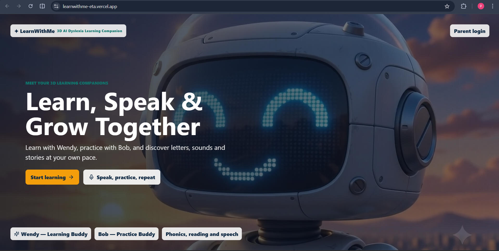

### 02. Learning dashboard

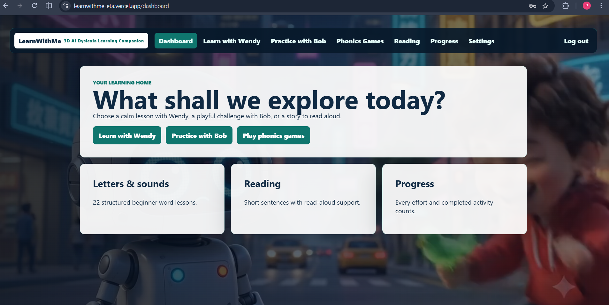

### 03. Wendy 3D companion stage

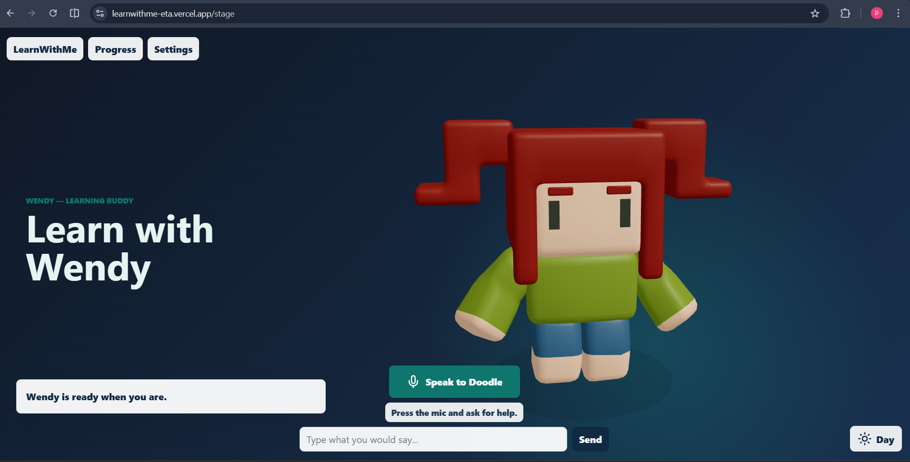

### 04. Wendy chat and speech interface

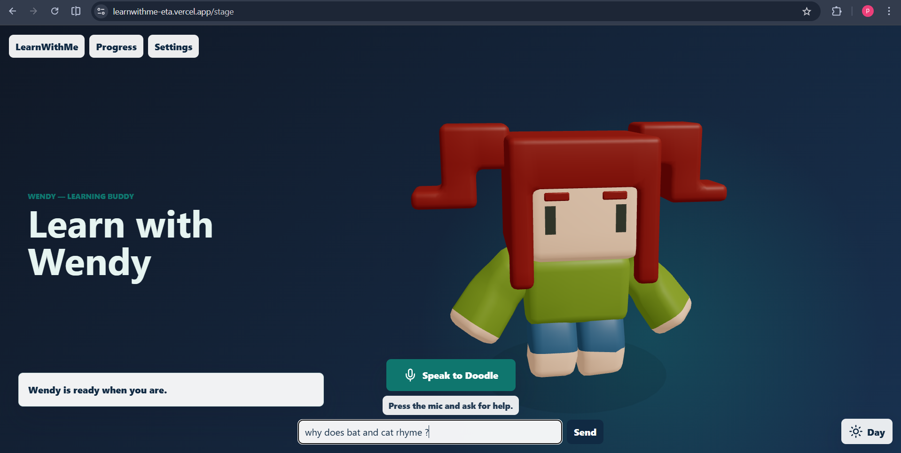

### 05. Wendy answering a rhyming question

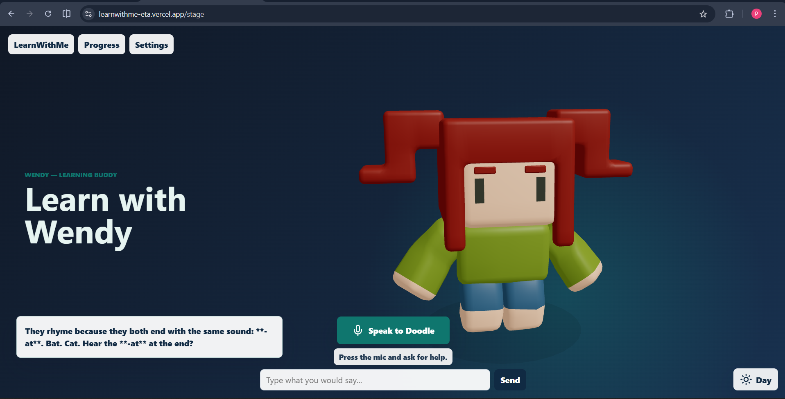

### 06. Guided phonics lesson

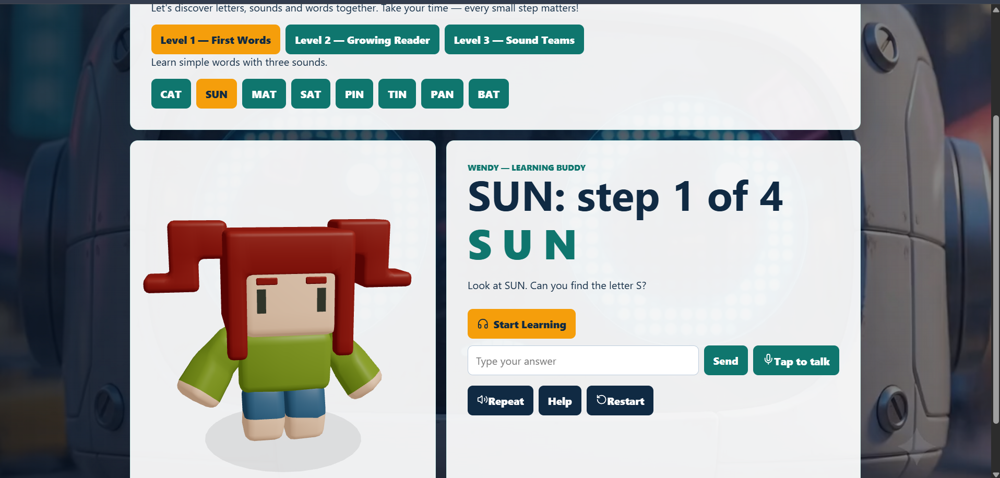

### 07. Bob practice companion

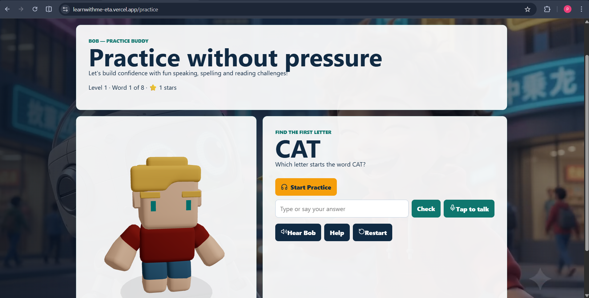

### 08. Letter tracing activity

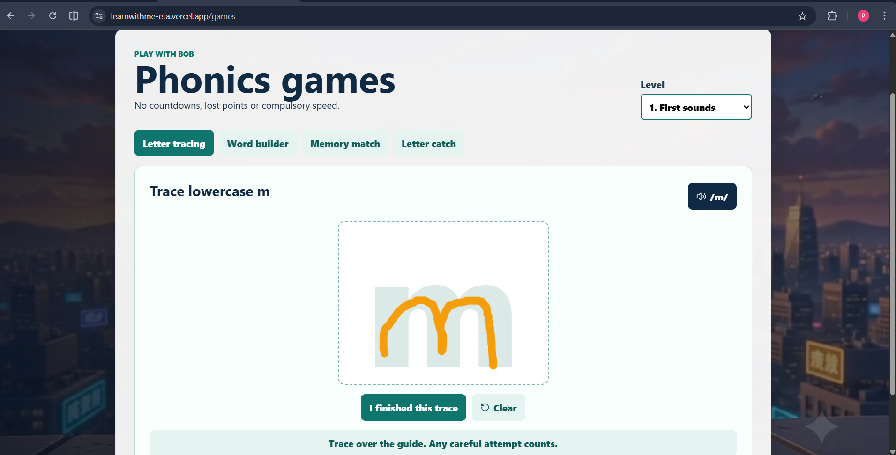

### 09. Word-building activity

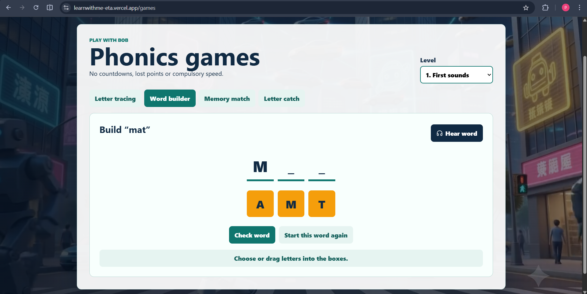

### 10. Memory matching game

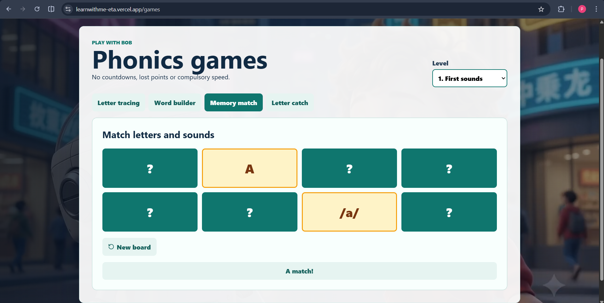

### 11. Letter catch game

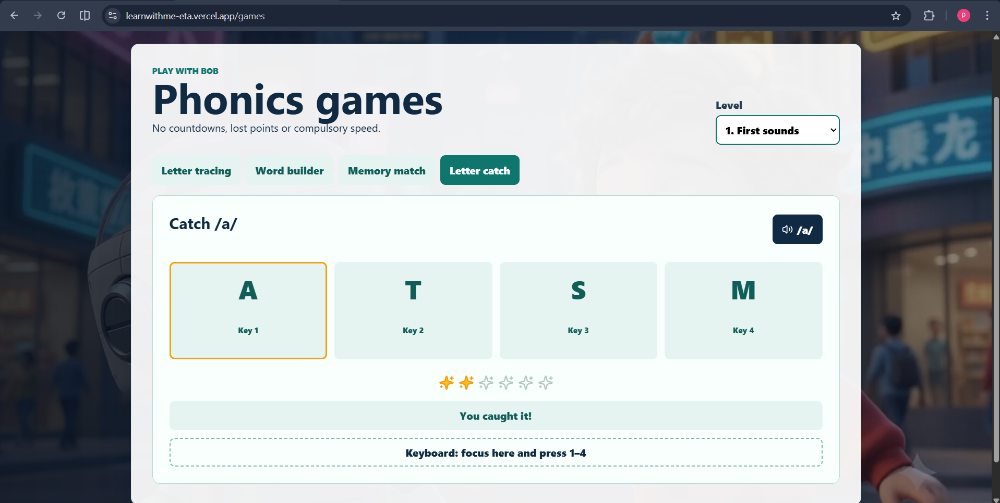

### 12. Reading activity

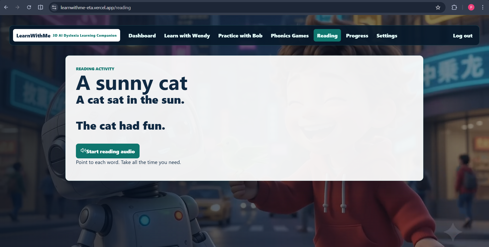

### 13. Accessibility settings

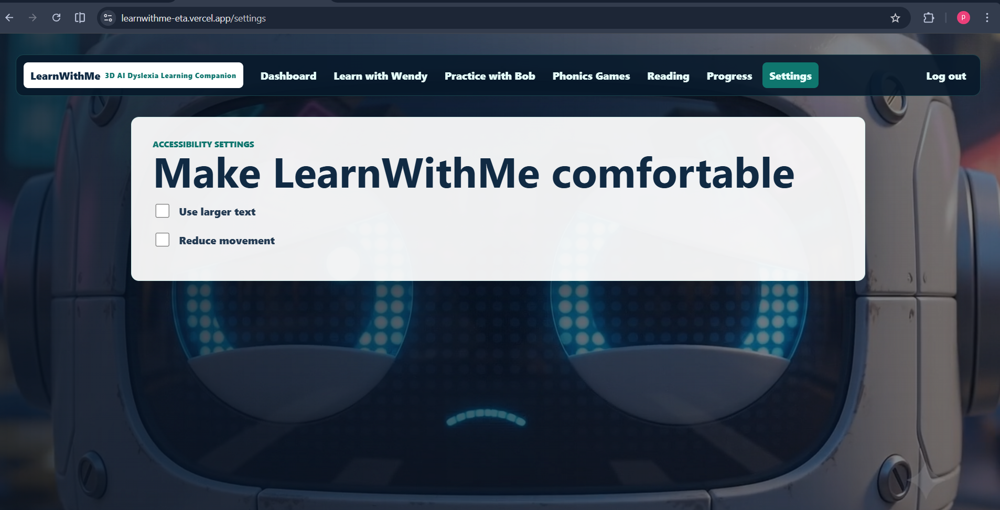

---

<div align="center">

**LearnWithMe — Every small step matters.**

[Back to top](#learnwithme--3d-ai-dyslexia-learning-companion) · [Open the live app](https://learnwithme-eta.vercel.app/)

</div>
